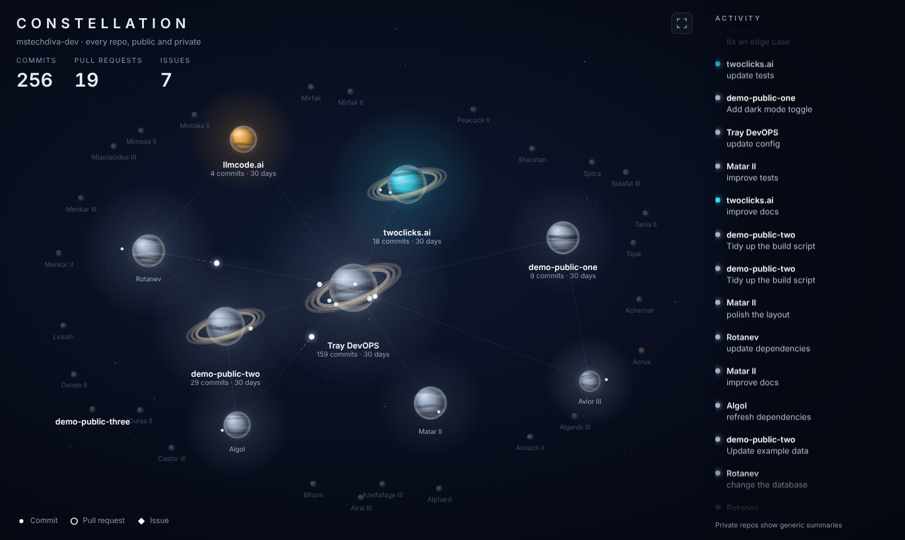

# Constellation

A live, animated map of everything I build on GitHub. Each repo is a planet. Commits, pull requests and issues travel between them as small pulses, and a feed on the right scrolls what is happening.



The screenshot uses invented sample data.

## What you are looking at

- **Planets** are repos I own, public and private. Busy ones glow and sit near the middle. Quiet ones are dim and drift toward the edges.
- **Moons** are branches. Bigger moons have more commits.
- **Pulses** are activity: a dot is a commit, a ring is a pull request, a diamond is an issue.
- **Colors**: the brightest colors mark repos that belong to an announced project. Every other planet gets its own muted color, picked from its name.
- **Totals** at the top are the last 30 days, updated once a day.

Public repos show their real names and commit messages. Private repos get star names and generic one-line summaries, so the shape of the work shows without the details.

## How it works

1. A scheduled GitHub Action reads the last 30 days of activity through the GitHub API with a read-only token.
2. A script turns that into a small `data.json` built from scratch with only a few allowed fields. It has no dates, times, commit hashes or links.
3. A leak check validates the file against a strict schema and blocks the deploy if anything looks wrong.
4. The static page in `site/` is published to GitHub Pages and animates the data in the browser.

Nothing is stored between runs and nothing is committed by the update job. The numbers are rebuilt from GitHub every time.

## Run it locally

```
npm test           # unit tests
npm run sample     # build fake data into site/data.sample.json
npm run preview    # serve site/ at http://127.0.0.1:8080
```

Opened on `localhost`, the page falls back to the sample data when there is no real `data.json`.

## Set it up for your own account

1. Fork or copy this repo and keep it private until you have reviewed the first output.
2. Create a fine-grained personal access token with read-only access to your repos (Contents, Metadata, Pull requests, Issues) and save it as the repository secret `GH_FETCH_TOKEN`.
3. Add these repository secrets:
   - `STAR_SALT`: a long random string. It keeps private repo star names stable and unguessable.
   - `SITE_NAMES`: JSON mapping a repo name to a public label for projects you want named.
   - `VENTURE_MAP`: JSON mapping a repo name to a project key, used only for color.
   - `ANNOUNCED_VENTURES`: JSON list of project keys that get their own color.
4. Run the **Update** workflow by hand. It does a dry run and uploads `data.json` for you to read before anything is published.
5. When you are happy, make the repo public, set Pages to deploy from GitHub Actions, and run **Update** again with the deploy option on. After that it runs every four hours.

## License

MIT. Copyright (c) 2026 XYZ Agents LLC.
